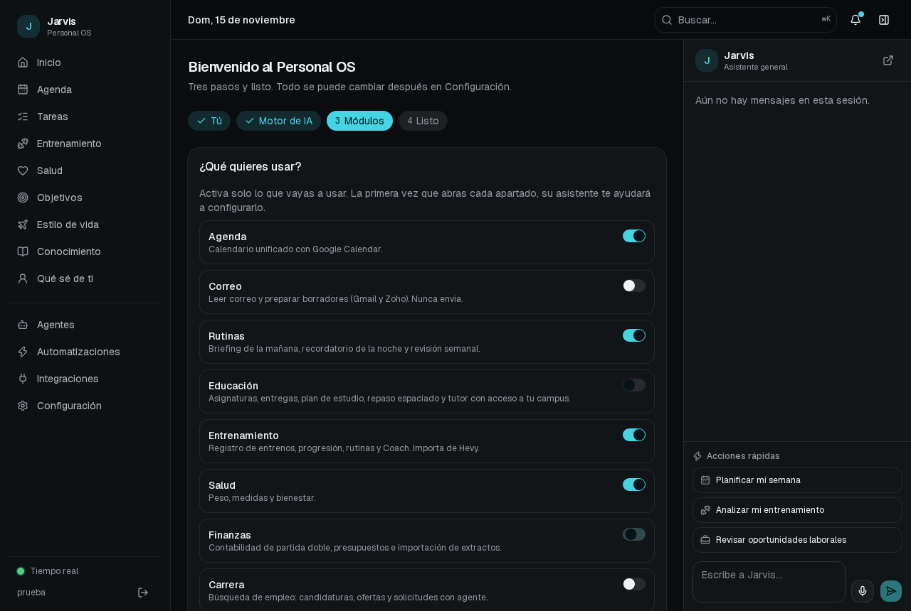
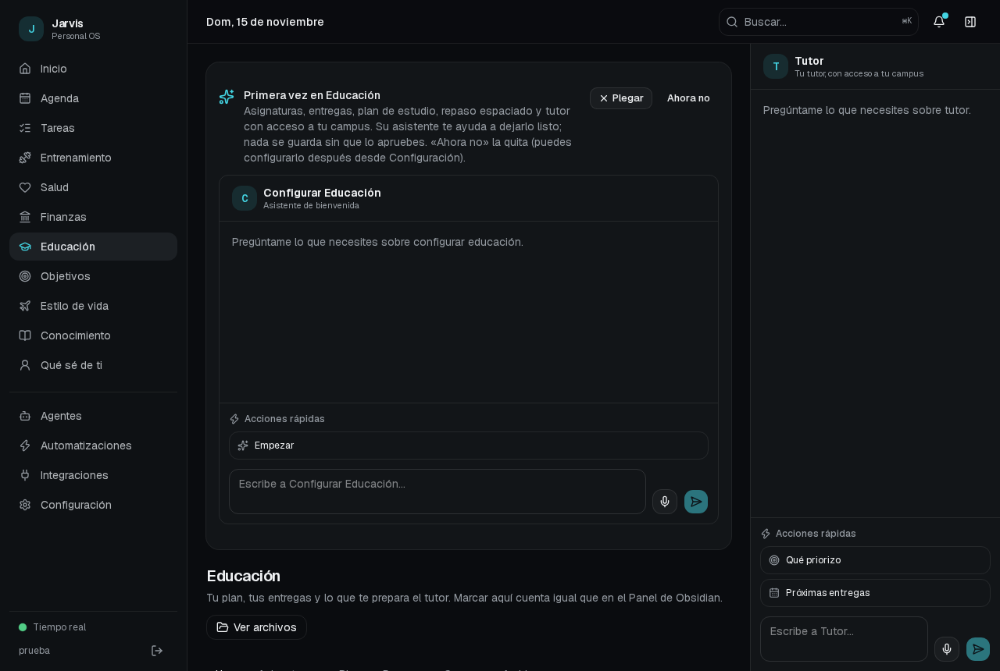

# Personal OS

Un asistente personal que vive en tu PC. Organiza tu agenda, tus tareas, tus estudios, tu entrenamiento, tus finanzas
y tu búsqueda de empleo desde un panel web privado, con un asistente de IA en cada apartado. Tus datos se quedan en tu
máquina; el modelo de IA solo ve lo que necesita en cada turno.


## Qué hace

- **Inicio:** Jarvis, que lo ve todo, con check-in de mañana y noche, avisos y un resumen de tu día.
- **Un asistente por apartado.** Cada uno solo ve lo suyo y solo puede hacer lo suyo.
- **Módulos que activas y desactivas:** Agenda, Correo, Educación, Entrenamiento, Salud, Finanzas, Carrera, Objetivos,
  Estilo de vida, Conocimiento (tu vault de Obsidian), Proyectos (GitHub), Ayudante, Vídeos, Ordenadores virtuales,
  Voz y avisos por Telegram. Lo desactivado desaparece del panel y ningún agente puede usarlo.
- **Rutinas:** briefing por la mañana, recordatorio por la noche y revisión semanal.
- **Elige tu motor de IA:** Claude Code, Codex (ChatGPT), OpenRouter (con OpenCode) o Antigravity.
- **Onboarding guiado:** la primera vez que abres un apartado, su asistente te ayuda a configurarlo. Nada se guarda
  sin tu aprobación. El de Educación puede abrir tu campus virtual en un navegador aislado y leer asignaturas,
  entregas y calendario por ti.

| Motor de IA | Módulos | Primera vez en un apartado |
|---|---|---|
|  |  |  |

## Instalación rápida

Si ya tienes Docker, Python 3.12+, [uv](https://docs.astral.sh/uv/), Node 20+ y git:

```bash
git clone https://github.com/badia-41v4r0/personal-os.git && cd personal-os
bin/pos instalar            # o «bin/pos instalar --simular» para ver qué haría sin tocar nada
```

Abre la dirección que te indica (por defecto `http://127.0.0.1:8770`), entra con tu usuario y sigue la bienvenida.
Si no, sigue los pasos de abajo.

## Instalación paso a paso (con Docker)

### Qué va en Docker y qué no

| Pieza | Dónde corre | Por qué |
|---|---|---|
| Cada turno de IA (Claude, Codex, OpenCode) | Contenedor efímero `<instancia>:local` | Aísla al modelo: sin tu `$HOME`, sin Docker, sin privilegios |
| Proxy de salida de Codex y OpenCode | Contenedor efímero | Solo deja salir a la API del motor |
| Ordenadores virtuales (terminal, navegador, campus) | Contenedores `<instancia>-vc:*` | Donde los agentes ejecutan código o navegan, sin red ni credenciales |
| PostgreSQL (opcional) | Contenedor `<instancia>-db` | Base de datos con búsqueda semántica |
| Whisper (voz y vídeos, opcional) | Contenedor `<instancia>` | Transcripción local |
| Panel (backend + web) y Host Agent | Servicios de tu usuario (systemd), no en Docker | El Host Agent es quien lanza los contenedores de arriba. Meterlo en Docker obligaría a darle el socket de Docker, que equivale a darle root: el proyecto no lo hace por seguridad |

Por eso hace falta Linux con systemd: no basta con `docker compose up`.

### 1. Instala Docker

Ubuntu, Debian o Fedora (script oficial de Docker):

```bash
curl -fsSL https://get.docker.com | sh
```

Arch:

```bash
sudo pacman -S docker docker-compose
```

En cualquier distribución, después:

```bash
sudo systemctl enable --now docker      # que arranque con el sistema
sudo usermod -aG docker $USER           # usar Docker sin sudo
```

**Cierra sesión y vuelve a entrar** para que valga el grupo. Comprueba que funciona sin `sudo`:

```bash
docker run --rm hello-world
docker compose version
```

> Si usas una VPN que intercepta el tráfico (p. ej. Cloudflare WARP), puede romper las redes nuevas de Docker. Los
> contenedores del proyecto usan la red `bridge` por defecto o ninguna, así que no debería afectar.

### 2. Instala el resto de requisitos

| Requisito | Cómo |
|---|---|
| git | Con el gestor de paquetes (`apt install git`, `dnf install git`, `pacman -S git`) |
| Python 3.12 o más | Viene en Ubuntu 24.04+, Fedora 40+ y Arch. Comprueba con `python3 --version` |
| uv | `curl -LsSf https://astral.sh/uv/install.sh \| sh` (y abre otra terminal) |
| Node 20 o más | Con el gestor de paquetes si te da 20+, o con [nvm](https://github.com/nvm-sh/nvm): `nvm install 22` |

Opcional: `sudo loginctl enable-linger $USER` para que el panel siga funcionando con tu sesión cerrada.

### 3. Instala y conecta el motor de IA

Solo el que vayas a usar (se puede cambiar después):

| Motor | Instalar | Conectar |
|---|---|---|
| Claude Code | `npm install -g @anthropic-ai/claude-code` | `claude setup-token`: el token se pone en el paso 6 |
| Codex | `npm install -g @openai/codex` | `codex login`, y después «Conectar Codex» en el panel |
| OpenRouter | `npm install -g opencode-ai` | Tu clave de openrouter.ai, en el panel |

La imagen de Docker trae las tres CLI. Las del PC solo sirven para iniciar sesión.

### 4. Descarga el proyecto

```bash
git clone https://github.com/badia-41v4r0/personal-os.git
cd personal-os
```

La carpeta donde lo clones es donde vivirán tus datos (`data/`, `Jarvis-Vault/`, `archivos/`).

### 5. Instala

Primero mira qué va a hacer, sin tocar nada:

```bash
bin/pos instalar --simular
```

Y después, de verdad:

```bash
bin/pos instalar
```

Opciones: `--instancia NOMBRE` (por defecto `pos`), `--puerto N` (por defecto el primero libre desde el 8770),
`--usuario NOMBRE` (por defecto tu usuario de Linux) y `--sin-ordenadores` (no construye las imágenes de los
ordenadores virtuales; el tutor no podrá abrir tu campus).

Lo que construye en Docker (la primera vez tarda varios minutos y ocupa varios GB):

| Imagen | Para qué |
|---|---|
| `<instancia>:local` | Turnos de IA, Whisper y el programador |
| `<instancia>-vc:egress` | Proxy de los ordenadores con salida filtrada |
| `<instancia>-vc:terminal`, `:desktop`, `:canvas`, `:aplicaciones` | Ordenadores virtuales (salvo con `--sin-ordenadores`) |

Al final te pide la contraseña del panel.

### 6. Si usas Claude, pon tu token

Edita `.env` (permisos 600, no se sube a git) y pega el token del paso 3:

```bash
CLAUDE_CODE_OAUTH_TOKEN=sk-ant-...
```

Después:

```bash
bin/pos actualizar
```

### 7. Abre el panel

`http://127.0.0.1:8770` (o el puerto que te indicó). Entra con tu usuario y sigue la bienvenida: tu nombre y áreas,
motor de IA y módulos.

### 8. Opcional: más servicios en Docker

**PostgreSQL** (en vez de SQLite; necesario para la búsqueda semántica):

```bash
control-center/deployment/pasar-a-postgres.sh
```

Arranca el contenedor `<instancia>-db` (solo en `127.0.0.1`), copia los datos y cambia el panel. Si falla, el panel
sigue en SQLite.

**Voz y vídeos** (Whisper local):

```bash
docker compose up -d jarvis
```

`jarvis` es el nombre del servicio en `docker-compose.yml`. El contenedor se llama como tu instancia.

### 9. Comprueba que todo va bien

```bash
bin/pos comprobar                                    # requisitos, servicios, permisos y disco
bin/pos estado                                       # servicios y salud del panel
docker images | grep <instancia>                     # imágenes construidas
docker ps --filter label=<instancia>.vc              # ordenadores virtuales en marcha
journalctl --user -u <instancia>-cc-backend -n 50    # registro del panel
```

### Problemas frecuentes

| Síntoma | Solución |
|---|---|
| `permission denied ... docker.sock` | Tu usuario no está en el grupo `docker`, o no has vuelto a iniciar sesión (paso 1) |
| «Hace falta Python 3.12» | Actualiza Python o usa una distribución más reciente |
| El puerto 8770 está ocupado | El instalador elige otro solo; o pasa `--puerto 8780` |
| `docker build` falla por falta de espacio | Libera espacio. `docker system df` enseña lo que ocupa Docker |
| El panel no abre | `journalctl --user -u <instancia>-cc-backend -n 50` |
| Los servicios se paran al cerrar sesión | `sudo loginctl enable-linger $USER` |

### Actualizar y desinstalar

```bash
git pull && bin/pos actualizar         # copia de la base, recompila y reinicia; tus datos no se tocan
bin/pos desinstalar                    # quita servicios y contenedores; tus datos se quedan
bin/pos desinstalar --borrar-datos     # y además borra base, vault y archivos (pide confirmación)
docker image rm $(docker images --format '{{.Repository}}:{{.Tag}}' | grep '^<instancia>')   # liberar las imágenes
```

Más detalles (móvil con Tailscale, copias de seguridad, varias instalaciones en el mismo PC) en
[docs/instalacion.md](docs/instalacion.md).

## Documentación

- [Instalación](docs/instalacion.md): requisitos, opciones, móvil con Tailscale, actualizar y desinstalar.
- [Guía de uso](docs/guia-de-uso.md): qué hace cada apartado y cómo sacarle partido.
- [Motores de IA](docs/motores-de-ia.md): qué puede hacer cada uno, cómo conectarlo y qué cuesta.
- [Seguridad y privacidad](docs/seguridad.md): qué ve cada agente, qué sale de tu PC y qué no.
- [Crear un módulo](docs/modulos.md): para quien quiera extenderlo.
- Documentación técnica por tema en [control-center/docs/](control-center/docs/).

## Cómo está hecho

```
 Navegador (PC o móvil por Tailscale)
        │ solo 127.0.0.1 o tu tailnet
 ┌──────▼───────────────────────────┐      ┌──────────────────────────────┐
 │ Backend (FastAPI) + web (Next.js) │◄────►│ Host Agent (socket Unix)     │
 │ SQLite o PostgreSQL · módulos     │      │ systemd · Docker · métricas  │
 │ acciones con aprobación · memoria │      │ lista cerrada y auditada     │
 └──────┬───────────────────────────┘      └──────┬───────────────────────┘
        │ lee y escribe                            │ lanza
 ┌──────▼──────────┐                ┌──────────────▼─────────────────────────┐
 │ Vault Obsidian   │                │ Contenedor efímero por turno de IA     │
 │ (tus notas)      │                │ (Claude, Codex u OpenCode), sin $HOME, │
 └─────────────────┘                │ sin Docker, sin privilegios; escribe   │
                                     │ solo por acciones del Personal OS      │
                                     └────────────────────────────────────────┘
```

## Licencia

[PolyForm Noncommercial 1.0.0](LICENSE): puedes usarlo, modificarlo y compartirlo **sin fines comerciales** (uso
personal, estudio, investigación, organizaciones sin ánimo de lucro). El uso comercial está reservado al autor; si lo
quieres para un uso comercial, escríbele. Para contribuir, mira [CONTRIBUTING.md](CONTRIBUTING.md).

## Estado

Proyecto personal publicado tal cual. Funciona en Linux. En Docker Desktop (Mac o Windows) el panel podría funcionar,
pero el monitor del PC, la voz y los ordenadores virtuales no. Documentación e interfaz en español.

Usar tu suscripción de un proveedor de IA con este proyecto es responsabilidad tuya: revisa sus condiciones de uso.
