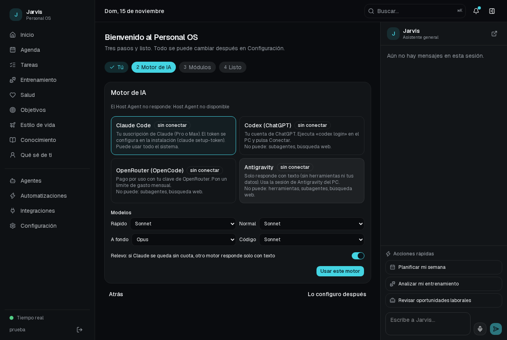

# Personal OS

Un asistente personal que vive en tu PC. Organiza tu agenda, tus tareas, tus estudios, tu entrenamiento, tus finanzas
y tu búsqueda de empleo desde un panel web privado, con un asistente de IA en cada apartado. Tus datos se quedan en tu
máquina; el modelo de IA solo ve lo que necesita en cada turno.


## Qué hace

- **Inicio:** Jarvis, que lo ve todo, con check-in de mañana y noche, avisos y un resumen de tu día.
- **Un asistente por apartado.** Cada uno solo ve lo suyo y solo puede hacer lo suyo.
- **Módulos que activas y desactivas:** Agenda, Correo, Educación, Entrenamiento, Salud, Finanzas, Carrera, Objetivos,
  Estilo de vida, Conocimiento (tu vault de Obsidian), Proyectos (GitHub), Ayudante, Vídeos, Ordenadores virtuales,
  Voz y avisos por Telegram. Lo desactivado desaparece del panel y ningún agente puede usarlo.
- **Rutinas:** briefing por la mañana, recordatorio por la noche y revisión semanal.
- **Elige tu motor de IA:** Claude Code, Codex (ChatGPT), OpenRouter (con OpenCode) o Antigravity.
- **Onboarding guiado:** la primera vez que abres un apartado, su asistente te ayuda a configurarlo. Nada se guarda
  sin tu aprobación. El de Educación puede abrir tu campus virtual en un navegador aislado y leer asignaturas,
  entregas y calendario por ti.

| Motor de IA | Módulos | Primera vez en un apartado |
|---|---|---|
|  |  |  |

## Instalación rápida

Requisitos: Linux con systemd, Docker con compose, Python 3.12+ con [uv](https://docs.astral.sh/uv/), Node 20+ y git.
Además, la CLI del motor de IA que vayas a usar.

```bash
git clone <url-del-repo> personal-os && cd personal-os
bin/pos instalar            # o «bin/pos instalar --simular» para ver qué haría sin tocar nada
```

Abre la dirección que te indica (por defecto `http://127.0.0.1:8770`), entra con tu usuario y sigue la bienvenida.
Detalles, opciones y acceso desde el móvil en [docs/instalacion.md](docs/instalacion.md).

## Documentación

- [Instalación](docs/instalacion.md): requisitos, opciones, móvil con Tailscale, actualizar y desinstalar.
- [Guía de uso](docs/guia-de-uso.md): qué hace cada apartado y cómo sacarle partido.
- [Motores de IA](docs/motores-de-ia.md): qué puede hacer cada uno, cómo conectarlo y qué cuesta.
- [Seguridad y privacidad](docs/seguridad.md): qué ve cada agente, qué sale de tu PC y qué no.
- [Crear un módulo](docs/modulos.md): para quien quiera extenderlo.
- Documentación técnica por tema en [control-center/docs/](control-center/docs/).

## Cómo está hecho

```
 Navegador (PC o móvil por Tailscale)
        │ solo 127.0.0.1 o tu tailnet
 ┌──────▼───────────────────────────┐      ┌──────────────────────────────┐
 │ Backend (FastAPI) + web (Next.js) │◄────►│ Host Agent (socket Unix)     │
 │ SQLite o PostgreSQL · módulos     │      │ systemd · Docker · métricas  │
 │ acciones con aprobación · memoria │      │ lista cerrada y auditada     │
 └──────┬───────────────────────────┘      └──────┬───────────────────────┘
        │ lee y escribe                            │ lanza
 ┌──────▼──────────┐                ┌──────────────▼─────────────────────────┐
 │ Vault Obsidian   │                │ Contenedor efímero por turno de IA     │
 │ (tus notas)      │                │ (Claude, Codex u OpenCode), sin $HOME, │
 └─────────────────┘                │ sin Docker, sin privilegios; escribe   │
                                     │ solo por acciones del Personal OS      │
                                     └────────────────────────────────────────┘
```

## Licencia

[PolyForm Noncommercial 1.0.0](LICENSE): puedes usarlo, modificarlo y compartirlo **sin fines comerciales** (uso
personal, estudio, investigación, organizaciones sin ánimo de lucro). El uso comercial está reservado al autor; si lo
quieres para un uso comercial, escríbele. Para contribuir, mira [CONTRIBUTING.md](CONTRIBUTING.md).

## Estado

Proyecto personal publicado tal cual. Funciona en Linux. En Docker Desktop (Mac o Windows) el panel podría funcionar,
pero el monitor del PC, la voz y los ordenadores virtuales no. Documentación e interfaz en español.

Usar tu suscripción de un proveedor de IA con este proyecto es responsabilidad tuya: revisa sus condiciones de uso.
