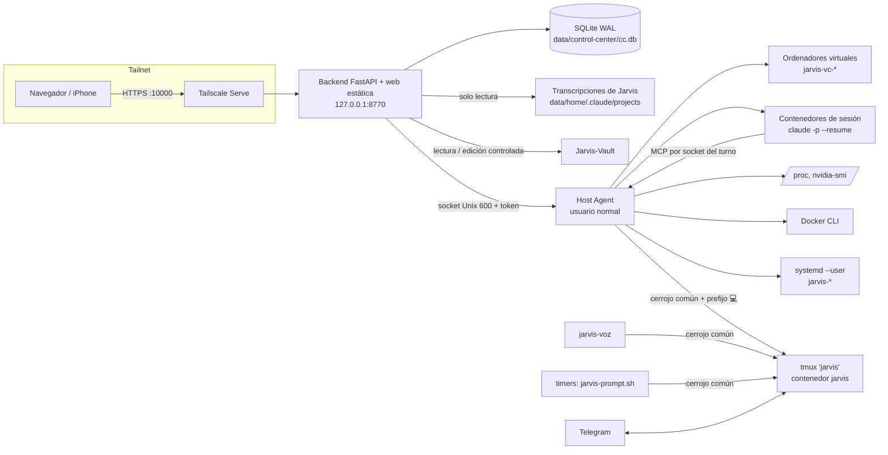

# Arquitectura del Jarvis Control Center

Monolito modular. Se añade al lado de Jarvis sin sustituir nada: si el panel se para, Jarvis sigue igual.

## Componentes

| Componente | Dónde corre | Por qué ahí |
|---|---|---|
| **Frontend** (Next.js 16, TS, Tailwind 4, shadcn/ui con Base UI, Lucide, Recharts) | export estático (`apps/web/out`) servido por el backend | Un proceso menos (RAM justa), mismo origen para cookie y WebSocket, sin CORS. En desarrollo: `npm run dev` en 127.0.0.1:3770 con proxy de `/api` |
| **Backend** (FastAPI, SQLAlchemy, Alembic) | `<instancia>-cc-backend.service` (usuario), `127.0.0.1:8770` | Sin Docker socket ni privilegios. Lee la vault y los JSONL con el usuario normal. Sirve la web con CSP |
| **Host Agent** | `<instancia>-cc-hostagent.service` (usuario), socket `$XDG_RUNTIME_DIR/<instancia>-cc/hostagent.sock` | Única pieza que llama a `systemctl`, `journalctl` y `docker`. Lista cerrada de capacidades, auditada |
| **SQLite** | `data/control-center/cc.db` (700) | Datos propios del panel. Copia con `sqlite3 .backup` (M10) |

Se descartó meter el panel en Docker: el backend necesitaría montar la vault, los JSONL y hablar con el Host Agent; como procesos de usuario es más simple y igual de aislado (el Host Agent es la frontera). Reiniciar el panel no toca el contenedor `jarvis`.

## Flujos

- **Leer el chat principal:** el backend sigue el JSONL más reciente por offset de bytes y lo normaliza (`adapters/transcript.py`): canal (telegram, voz, video, web, sistema), llamadas a herramientas y resultados. El razonamiento interno no se expone.
- **Escribir en la principal (M3, hecho):** `POST /sessions/main/messages` → ejecución (AgentRun) en la cola del backend (una, FIFO) → Host Agent: limpia el texto (una línea, sin caracteres de control), **pone él el prefijo** `💻 [panel id=RUN]` (o `… tg]` si también va por Telegram) y teclea con el cerrojo común `$XDG_RUNTIME_DIR/jarvis-prompt.lock`, que también usan `bin/jarvis-prompt.sh` y `jarvis-voz` → el backend sigue el JSONL hasta el `turn_duration` de ese turno → siguiente. Interrumpir = Escape + cancelar las pendientes. Si el backend se reinicia con algo pendiente, se marca como error y no se reenvía (para no duplicar).
- **Sesiones independientes (M3):** cada una con su contenedor efímero (perfil `sesion`, igual que `ayudante`), su `HOME` en `data/sesiones/<id>`, sin vault salvo que se conceda, y `claude -p --output-format stream-json --resume`. El backend reenvía los eventos por WebSocket.
- **Eventos:** tabla `events` con id secuencial; WebSocket `/api/v1/ws?after=N` reenvía lo pendiente y luego en vivo; `GET /api/v1/events?after=N` como alternativa.

## Puertos

| Puerto | Escucha en | Uso |
|---|---|---|
| 8770 | 127.0.0.1 | Backend + web |
| 10000 | IP de Tailscale (Serve) | `https://<equipo>.<tailnet>.ts.net:<puerto>` → 8770 (aprobado y activo el 31/10) |
| 3770 | 127.0.0.1 | Solo en desarrollo (`npm run dev`) |

Ninguno en `0.0.0.0`. Sin Funnel. Sin puertos en el router.
